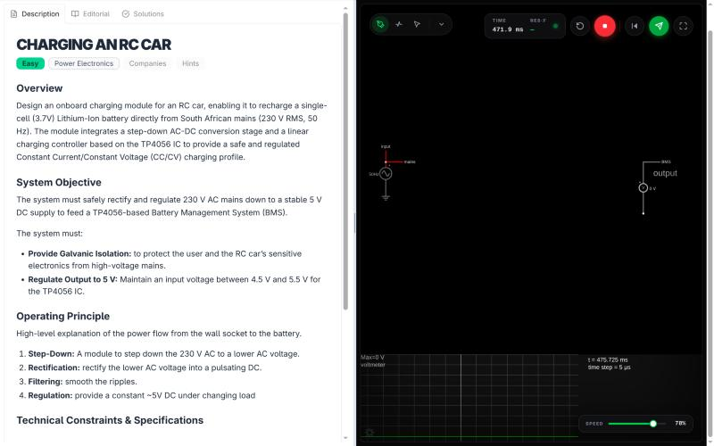
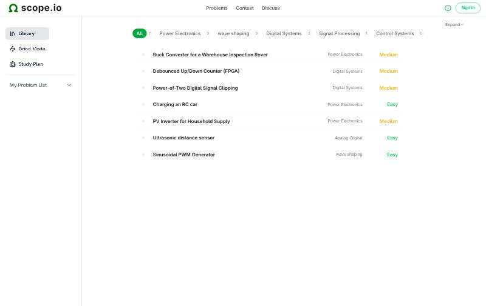
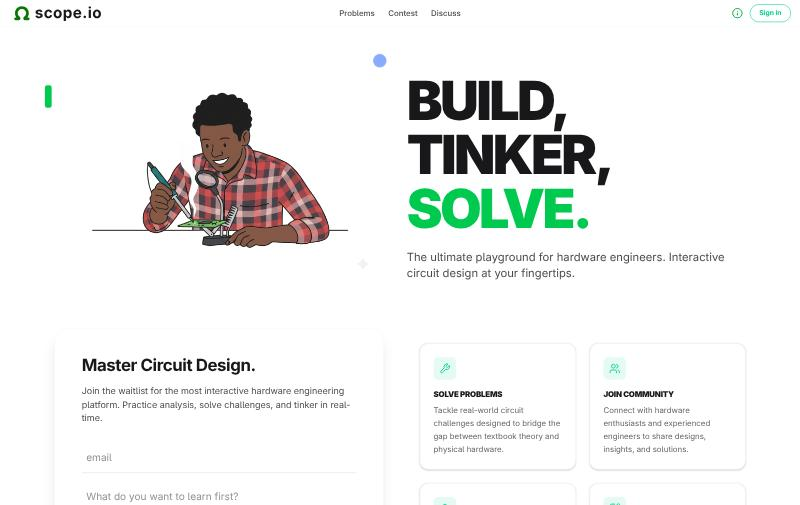
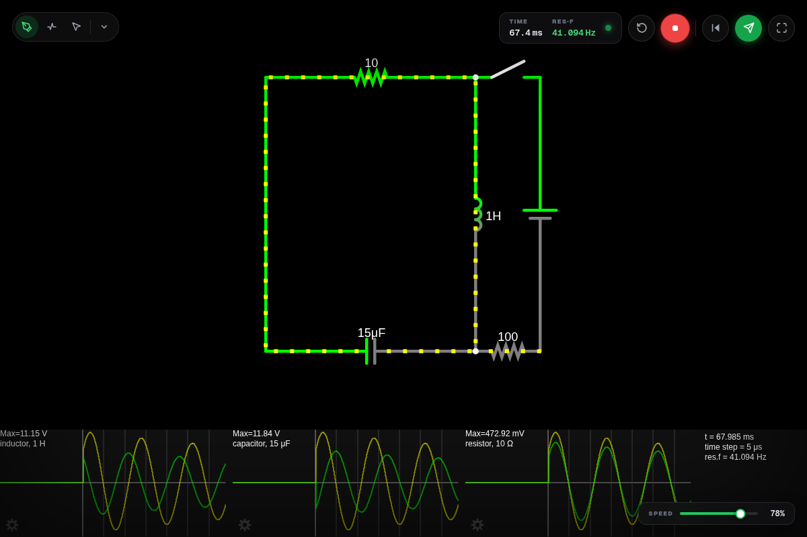
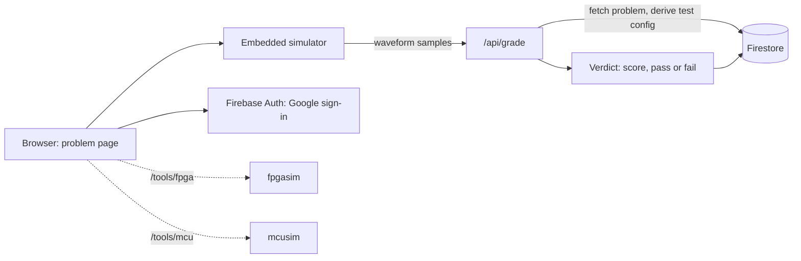

# scope.io

**A LeetCode-style platform for electronics engineers.** Pick a problem, solve it in an embedded simulator (analog circuits, Verilog on an FPGA, or bare-metal C on a microcontroller), and get graded automatically against a reference solution.

Early demo: **https://ohmify-pi.vercel.app** (Vercel and Firebase free tiers, see [docs/DEPLOYMENT.md](docs/DEPLOYMENT.md)). The problem library and analog simulator are open to browse. Sign-in with Google is needed to submit solutions.

<p align="center"></p>

*A problem page on the demo: the description and tabs on the left, the embedded CircuitJS simulator on the right.*

<p align="center">


</p>

*Left: the problem library, filterable by topic, with difficulty ratings. Right: the landing page and waitlist.*

<p align="center"></p>

*The embedded simulator mid-run: an RLC circuit with live scope traces and a resonant-frequency readout. The simulator's samples are what get graded.*

## How it works



- **Three kinds of problem.** Analog circuits run in an embedded [CircuitJS](https://github.com/PontshoMbizo/circuitjs1) simulator. Digital design problems run in [fpgasim](https://github.com/PontshoMbizo/fpgasim) (Verilog on a Tang Nano 9K). Firmware problems run in [mcusim](https://github.com/PontshoMbizo/mcusim) (bare-metal C on an STM32 Blue Pill). Both embed as iframes.
- **Automatic grading.** The simulator exports samples deterministically. The server compares them with a golden waveform and returns a verdict, so results are reproducible.
- **Creator workflow.** Creators and admins author problems at `/create` with a starter circuit, a reference solution and test cases.
- **Accounts and progress.** Google sign-in through Firebase Auth. Problems, submissions and user progress live in Firestore.

## Design choices

| Decision | Why |
|---|---|
| Grade on the server, and derive the test config from the stored problem | The client sends only the problem id and its samples. Topics, test type and testbench come from Firestore, so a user cannot pick an easier threshold |
| Hybrid error for analog problems: 70% time-domain NRMSE, 20% frequency-domain NRMSE, 10% key features (RMS, peak, settling time) | A waveform can match in shape but not in spectrum or timing. Blending the three is harder to game than any one |
| Exact cycle match for digital problems | Digital behaviour is right or wrong, so a tolerance would hide bugs |
| Pass thresholds per topic | A power-electronics waveform tolerates more error than a combinational circuit, so each topic has its own limit |
| Discovery by convention in the capture engine (voltmeter and labelled `input`, `clk`, `Output` elements) | Problem authors do not need to write glue code for each circuit |
| Firestore rules lock role, points and progress against client writes | Scores and roles can only change through the server |

## Findings

| Area | Result |
|---|---|
| Unit tests | 126 test cases in 7 Vitest files: grading, signal processing, sampling, waveform codec, netlist parsing, circuit discovery, general utilities |
| Problem set | 26 problems written (9 CircuitJS, 9 FPGA, 8 MCU), each with a model answer. 7 are seeded on the demo so far |
| FPGA model answers | Each design simulated against its self-checking testbench under Icarus Verilog |
| MCU model answers | Algorithmic core compiled and unit-tested on a host PC, then built as firmware for mcusim |
| App surface | 13 pages and 4 API routes (grade, account delete, admin problems, admin users) |
| Data model | 4 Firestore collections: Problems, Submissions, UserProgress, Users |
| CI | Lint, tests and a production build on every push |

### Pass thresholds for analog problems

| Topic | Maximum error |
|---|---|
| Power Electronics | 30% |
| RF Electronics | 12% |
| Signal Processing | 10% |
| Control Systems | 8% |
| Default | 5% |

Combinational, sequential and digital-systems problems use exact match instead.

### Limits

- The demo is early: 7 problems are seeded and there is no usage data yet.
- Grading works on submitted waveform samples, not on the circuit itself. Verifying the circuit is future work.
- Security rules live in `firestore.rules` and must be deployed to Firebase. The repo copy is not enough.
- Problem quality has only been checked by the author so far, not by outside testers.

## Run it locally

Requires Node 20+ and a Firebase project (Auth with Google sign-in, and Firestore).

```bash
npm install
cp .env.example .env.local     # fill in your Firebase web config and service account
firebase deploy --only firestore:rules,firestore:indexes
npm run dev                    # http://localhost:3000
```

```bash
npm test         # Vitest
npm run lint
npm run build
```

`.env.local` holds a real Firebase service-account key. It is git-ignored: never commit it, and rotate the key if it ever leaks.

To use the FPGA and MCU tools locally, run [fpgasim](https://github.com/PontshoMbizo/fpgasim) on port 3001 and [mcusim](https://github.com/PontshoMbizo/mcusim) on port 3002 and point `NEXT_PUBLIC_NIKA_URL` and `NEXT_PUBLIC_STM_URL` at them. See [docs/TOOLS.md](docs/TOOLS.md).

## Docs

[Architecture](docs/ARCHITECTURE.md), [simulator integration](docs/SIMULATOR.md), [tools](docs/TOOLS.md), [deployment](docs/DEPLOYMENT.md), [UI](docs/UI.md), [creator conventions](docs/CREATOR-CONVENTIONS.md), [route map](docs/route_map.md), [Firestore rules](docs/firestore_rules.md).

## Licence

GPL-2.0-or-later, see [LICENSE](LICENSE). scope.io embeds [circuitjs1](https://github.com/PontshoMbizo/circuitjs1) (a fork of Paul Falstad's CircuitJS, GPL-2.0-or-later) as the `public/circuitAPI` submodule, and the whole project is licensed to match. Other dependencies keep their own licences.
