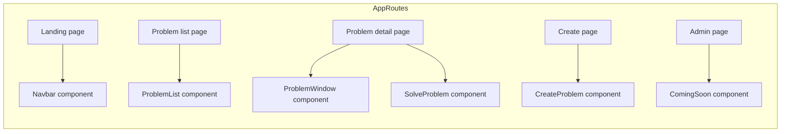
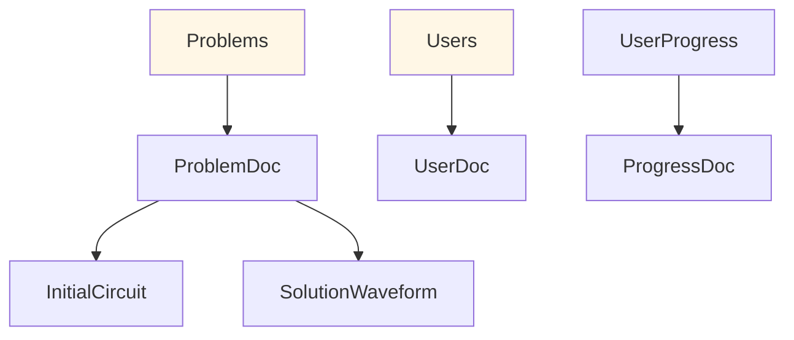

# Ohmify — Project Architecture

This repository implements Ohmify: a web platform for electronics problem solving that combines authored problems, embedded CircuitJS simulations, and automated verification/grading of circuit solutions.

This README documents the project architecture in a hierarchical way: a high-level overview, architecture diagrams, and detailed descriptions of routes, components, data model, and developer/run instructions.

## High-level purpose

- Provide a LeetCode-like experience for electronics engineers: browse problems, open an interactive/automated simulator, submit solutions, and receive automated feedback.
- Persist problems, circuits, and graded solution artifacts in Firestore and authenticate users with Firebase Auth (Google sign-in).
- Support deterministic sampling from CircuitJS for reproducible grading and CSV export for offline analysis.

## Tech stack

- Frontend: Next.js (App Router) + React 19
- Styling: Tailwind CSS + daisyUI
- Simulation: CircuitJS (embedded under `public/circuitAPI/`)
- Data & Auth: Firebase v12 (Auth + Firestore)
- Charts & math: Chart.js, react-chartjs-2, MathJax

## Architecture diagrams

High-level architecture (services and major responsibilities):

  ```mermaid
flowchart LR
  Browser -->|Next.js pages| NextApp[NextJS App Frontend]
  NextApp -->|uses| Firebase[Firebase Auth and Firestore]
  NextApp -->|embeds| CircuitJS[CircuitJS iframe]
  CircuitJS -->|exports| Waveforms[Waveform CSV samples]
  Firebase -->|stores| Firestore[Problems Users UserProgress]
  NextApp -->|renders| UI[Navbar ProblemList Simulator Grader]

  style NextApp fill:#f0f9ff,stroke:#67c4ff
  style Firebase fill:#fff4f0,stroke:#ffb37a
  style CircuitJS fill:#f6fff0,stroke:#b7e17a
  ```

Route → Component map (simplified):



Data model (core Firestore collections and typical document layout):



## Hierarchical walkthrough (high → low)

1) Application shell

- `app/layout.js` — global layout. Wraps the site with `AuthProvider` and renders the `Navbar`. See `app/layout.js`.

2) Entry pages

- `app/page.js` — Landing/marketing UI using `components/LandingPage/*`.
- `app/problem/page.js` — Problems listing page. Fetches `Problems` and the user's `UserProgress` (completed problems) and renders `components/ProblemList.jsx` and `components/Drawer.jsx`.
- `app/problem/[id]/page.js` — Problem detail; loads the problem metadata, the `initialCircuit` subdocument and `solutionWaveform` subcollection, then renders `ProblemWindow` and `SolveProblem`.

3) Authentication & user state

- `lib/firebase.js` — Firebase initialization using env vars `NEXT_PUBLIC_FIREBASE_*`.
- `components/Auth/AuthProvider.jsx` — listens to `onAuthStateChanged`, loads user full profile from `Users/{uid}` (or calls `syncUserDocument`), and exposes `useAuth()` with `user`, `loading`, `signIn`, and `signOut`.
- `lib/authUtils.js` — Google sign-in via popup and `syncUserDocument()` that creates a `Users/{uid}` doc.

4) Problem CRUD and data flow

- Problems are stored in the `Problems` collection. Each `Problems/{id}` can contain subcollections such as `initialCircuit` (document `data`) and `solutionWaveform` (documents with `samples`, `sampleRate`, metadata).
- When viewing a problem (`app/problem/[id]/page.js`), the page fetches the metadata + `initialCircuit/data` + `solutionWaveform` docs and passes them to the simulator/grader components.

5) Simulation & Grading

- `components/Simulator.jsx` (and `components/SimulationWindow/*`) embed CircuitJS (from `public/circuitAPI/`) in an iframe, programmatically import netlist/payload, and deterministically advance the simulator to capture samples.
- Captured waveforms are normalized (units) and exported as CSV or compared against stored solution waveforms for grading.
- Grading strategies documented in `TASKS.md` include time-domain comparison (std deviation / RMS), digital logic table matching, and clock-synchronized sampling for digital problems.

6) UI components

- `components/Navbar.jsx` — global navigation; uses `useAuth()` for conditional UI (Create/Admin links, avatar, sign-in/out).
- `components/ProblemList.jsx` — topic filters, difficulty badges, and completion markers (reads a `Set` of completed problem ids from `app/problem/page.js`).
- `components/ProblemDescriptionWindow/*` — problem statement, editorial, sample solutions UI.
- `components/SimulationWindow/*` — SolveProblem, auto-marker, and simulator controls.

## Developer: run & env instructions

1. Install deps

```bash
npm install
```

2. Local environment variables (create a `.env.local` at project root). Minimum required keys:

- `NEXT_PUBLIC_FIREBASE_API_KEY`
- `NEXT_PUBLIC_FIREBASE_AUTH_DOMAIN`
- `NEXT_PUBLIC_FIREBASE_PROJECT_ID`
- `NEXT_PUBLIC_FIREBASE_STORAGE_BUCKET`
- `NEXT_PUBLIC_FIREBASE_MESSAGING_SENDER_ID`
- `NEXT_PUBLIC_FIREBASE_APP_ID`
- `NEXT_PUBLIC_FIREBASE_MEASUREMENT_ID` (optional)

Example `.env.local` (do not commit):

```env
NEXT_PUBLIC_FIREBASE_API_KEY=your_api_key
NEXT_PUBLIC_FIREBASE_AUTH_DOMAIN=your_project.firebaseapp.com
NEXT_PUBLIC_FIREBASE_PROJECT_ID=your_project_id
NEXT_PUBLIC_FIREBASE_STORAGE_BUCKET=your_project.appspot.com
NEXT_PUBLIC_FIREBASE_MESSAGING_SENDER_ID=...
NEXT_PUBLIC_FIREBASE_APP_ID=...
```

3. Run locally

```bash
npm run dev
```

4. Notes about local simulator assets

- The embedded CircuitJS runtime and helper pages live in `public/circuitAPI/`. Those files are loaded into an iframe by `components/Simulator.jsx`.

## Where to look for core logic (quick pointers)

- Firebase init: `lib/firebase.js`
- Auth helpers: `lib/authUtils.js`
- Auth provider: `components/Auth/AuthProvider.jsx`
- Root layout: `app/layout.js`
- Problems list: `app/problem/page.js` + `components/ProblemList.jsx`
- Problem detail + grader: `app/problem/[id]/page.js` + `components/SimulationWindow/*`
- Simulator iframe integration: `components/Simulator.jsx` and `public/circuitAPI/`

## Development notes & TODOs

- Deterministic sampling reliability needs verification (see `TASKS.md`). Increasing the sampling rate or using exported CSVs is a known workaround.
- Grading strategies vary by problem type: analog/time-domain (RMS/std-dev), frequency-domain (spectral comparison), digital (logic table + clock sync).

## Next steps you might want me to do

- Inspect `components/SimulationWindow/SolveProblem.jsx` and `components/Simulator.jsx` to summarize grading logic in detail.
- Generate a visual file tree or interactive route map for the repo.
- Create a small CONTRIBUTING.md with local test instructions and Firestore rules suggestions.

---

If you want, I can now open and summarize `components/SimulationWindow/SolveProblem.jsx` and `components/Simulator.jsx` to show exactly how grading is implemented.
