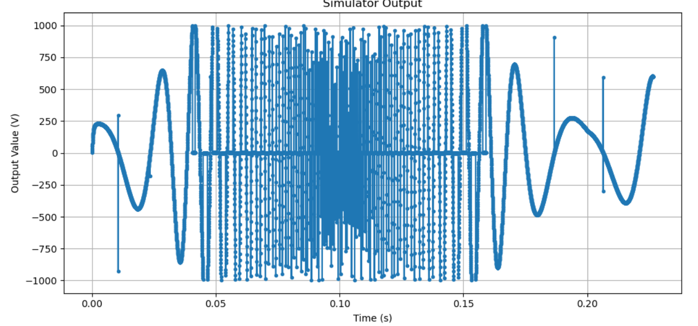

# Tasks to-do

## 1. (2025/12/2022) Create problem page
- created normal data collection fields and simulator instances.

- need to use export circuit 
- need to collect simulation data at the end
- need to connect to the database

## 2. Automarker

- check sampler integrity (does it sample correctly?) : the test failed, the sample frequency is not enough 
- use the data export functionality (for now)
-NB: find a way to store large simulation files

#### categorize problems and ways to verify the solutions:

- Power Electronics and wave-shaping
    - compare the time domain waveforms using standard deviation
    DONE

- Frequency Domain Problems (Audio, Controls...)

- Digital Electronics
    - come back later
