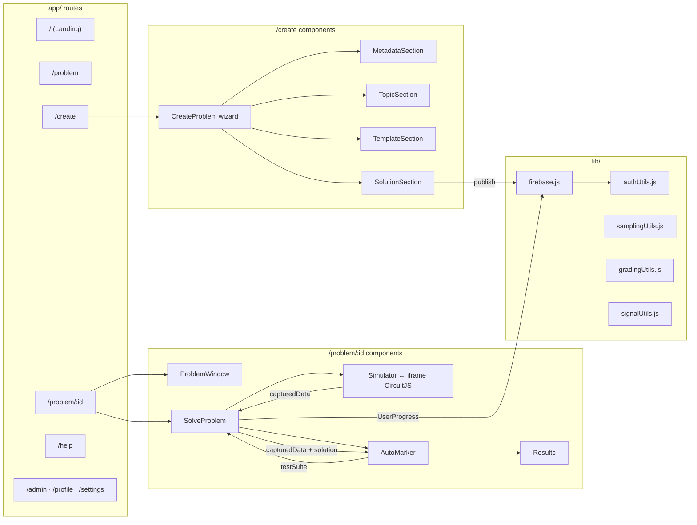

# Ohmify — Route & Component Map

## App Routes

| Route | File | Notes |
|---|---|---|
| `/` | `app/page.js` | Landing page |
| `/problem` | `app/problem/page.js` | Problem list; parallel Firestore fetch for problems + user progress |
| `/problem/:id` | `app/problem/[id]/page.js` | Problem detail + simulator; loads meta, `initialCircuit`, and `solutionWaveform` via `Promise.all` |
| `/create` | `app/create/page.js` | Problem creator — renders `CreateProblem` wizard |
| `/help` | `app/help/page.js` | User & creator guide |
| `/admin` | `app/admin/page.js` | Admin dashboard (placeholder) |
| `/profile` | `app/profile/page.js` | User profile (placeholder) |
| `/settings` | `app/settings/page.js` | Settings (placeholder) |
| `/business` | `app/business/page.js` | Business landing (placeholder) |
| `/education` | `app/education/page.js` | Education landing (placeholder) |
| `/ComingSoon` | `app/ComingSoon/page.js` | Generic coming-soon page |

---

## Component Tree

```
app/problem/page.js
  └─ ProblemList.jsx
       └─ Drawer.jsx

app/problem/[id]/page.js
  ├─ ProblemWindow.jsx  (left column)
  │    ├─ ProblemDescription.jsx
  │    │    └─ DigitalDataBlock.jsx
  │    ├─ Editorial.jsx
  │    └─ SampleSolution.jsx
  └─ SolveProblem.jsx  (right column)
       ├─ Simulator.jsx
       │    └─ (iframe → public/circuitAPI/circuitjs.html)
       └─ AutoMarker/
            ├─ AutoMarker.jsx
            └─ Results.jsx  (dynamic import, ssr: false)

app/create/page.js
  └─ CreateProblem.jsx  (4-step wizard)
       ├─ Step 0 → Sections/MetadataSection.jsx
       ├─ Step 1 → Sections/TopicSection.jsx
       ├─ Step 2 → Sections/TemplateSection.jsx
       └─ Step 3 → Sections/SolutionSection.jsx

app/layout.js
  └─ Navbar.jsx
       └─ Auth/AuthProvider.jsx  (provides useAuth() context)
```

---

## Key Shared Modules

| Module | Purpose |
|---|---|
| `lib/firebase.js` | Firebase app + Firestore instance |
| `lib/authUtils.js` | `syncUserDocument()` — creates/merges `Users/{uid}` on first sign-in |
| `lib/GeneralUtils.js` | `PROBLEM_TYPES`, `digitalTopics`, `isDigitalProblem()`, `toHex()`, `toDB()`, `formatSpectrumData()` |
| `lib/samplingUtils.js` | `captureAnalog()`, `captureDigital()` — simulator timestep callbacks |
| `lib/gradingUtils.js` | `gradeDigital()`, `calculateNormalizedRMSE()`, `getVerdict()`, `calculateFinalVerdict()` |
| `lib/signalUtils.js` | `getFrequencyData()` — FFT → Bode magnitude/phase + spectrum |
| `components/LoadingAnimation.jsx` | Shared spinner |

---

## Mermaid Diagram


